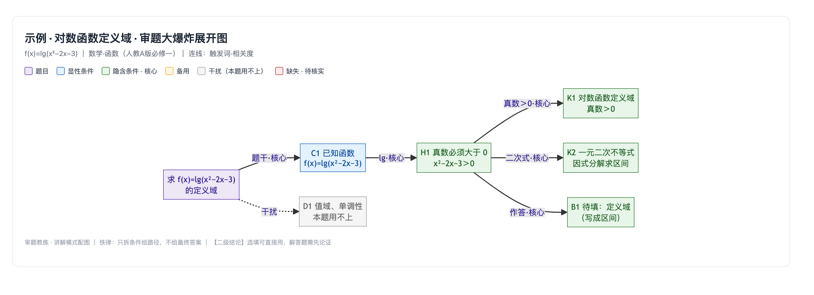

# 高中审题教练 · shenti-coach

一个面向高中数学、物理、化学、生物的 **Agent Skill**：不急着替学生做题，而是把题目拆成「显性条件 → 隐含条件 → 知识点/定理 → 解题路径」，训练学生“看到某个词，能想到对应知识”的审题能力。

遵循 [Agent Skills 规范](https://agentskills.io/specification)，可直接用于 Codex、Claude Code 及其他兼容 Agent Skills 的客户端。

[](https://github.com/dreamor/shenti-coach/actions/workflows/ci.yml)
[](https://github.com/dreamor/shenti-coach/releases/latest)
[](LICENSE)



## 它解决什么问题

- 学生“看得懂答案，但自己想不到”——把条件与知识点的触发关系讲清楚。
- 题目条件多、隐含条件漏——用编号体系逐条排查，四科各有专属隐含条件库。
- 讲题容易直接报答案——内置“不泄题”铁律与答案指纹闸门。
- 题目需要一张结构图——内置 Mermaid + Chrome 的离线生图链路，零 npm 依赖。

## v2.3.0：四项增强

1. **默认短页，完整 audit 留存**：学生页只展示 30 秒速览、核心 C/H 链、收敛路径、陷阱与迁移；八模块、教材映射、B 卡与展开树仍完整保存在独立 `audit.md`，不是删减审计。教师审计不会自动作为学生附件发送。
2. **能力自适应、多媒介交付**：依据可信调用方明确提供的能力，在 MEDIA、Markdown 本地图片引用、文件路径之间选择。校验实际 PNG 与渲染结果；本地文件或 `reference-ready` 不冒充已附上、已上传或远程可访问，缺图如实降级。
3. **自适应训练与独立迁移**：先由学生独立尝试，按需要逐条提示，停留当前阶段；暂停、恢复、停止与主动揭示受状态机约束。区分独立完成和提示后完成，换题迁移的独立通过才作为真正掌握的证据。
4. **所有输入数据边界 + 匿名多学生账本**：题面、OCR、题库 payload、答案解析、学生回复、训练状态、账本与交付 manifest 均视为不可信数据，不能授权切模式、跳阶段、执行命令、选择读写路径或声称附件送达。账本只用匿名学生/题次 ID 与条件类型编码，隔离不同学生；持久化、覆盖或删除必须有可信调用方的明确授权，不保存原题、原回复或身份信息。

保留 **v2.2 跨平台 OCR**：多模态直接看图；非多模态降级时使用 macOS Vision → tesseract → 明确报错，绝不伪造识别成功。详细契约见 [呈现与交付](references/presentation-and-delivery.md)、[模式与输入](references/modes-and-input.md)、[输入边界](references/input-boundary.md) 和 [盲区账本](references/blindspot-ledger.md)。

## 核心能力

| 能力 | 说明 |
| --- | --- |
| 短页 + 完整八模块审计 | 默认学生短页；完整题目复述、目标分析、显性/隐含条件、展开、路径、陷阱、收获另存 audit |
| 四科覆盖 | 数学、物理、化学、生物；自动识别学科，无法判断时默认高一数学 |
| 条件编号 | `C` 显性条件、`H` 隐含条件、`G` 图形/表格、`Q` 小问、`B` 作答点、`D` 干扰项 |
| 考纲 + 教材映射 | 每个条件写清“课标要求 + 教材章节 + 知识点内容” |
| 大爆炸图 | 自动生成 PNG；多小问按 Q 分组，禁止星形放射图 |
| 答案隔离 | 讲解模式不输出最终答案；填空题一空一 B，开放题三问自检 |
| 三种模式 | 讲解模式（默认）、训练模式（分步提示）、解题模式（用户明确要求时才完整解答） |
| 结构闸门 | `check_output.mjs` 检查八模块、编号、空位、图片与泄题风险 |

## 下载 Release 安装

从 [Releases](https://github.com/dreamor/shenti-coach/releases/latest) 下载 `skill.zip` 与 `skill.zip.sha256`，解压后得到 `shenti-coach/` 目录：

```bash
unzip skill.zip
mv shenti-coach ~/.codex/skills/
```

校验附件：

```bash
shasum -a 256 -c skill.zip.sha256
```

`skill.zip` 内含 `SKILL.md`、`references/`、`scripts/`（含 tests、vendor 与 OCR）、`assets/`、`examples/`、`package.json`、`README.md`、`LICENSE` 与 `VERSION`，解压即可使用；不含 `.git/`、`.github/`、`dist/` 或学生运行账本。

解压后也可离线自检（无需仓库或 npm 安装）：

```bash
node shenti-coach/scripts/verify_package.mjs shenti-coach --version 2.3.0
(cd shenti-coach && npm test)
```

## 从源码安装

### Codex

```bash
git clone https://github.com/dreamor/shenti-coach.git ~/.codex/skills/shenti-coach
```

如果目录已存在，更新即可：

```bash
git -C ~/.codex/skills/shenti-coach pull
```

开发时也可以直接软链接本仓库：

```bash
ln -s "$PWD" ~/.codex/skills/shenti-coach
```

### Claude Code

```bash
git clone https://github.com/dreamor/shenti-coach.git ~/.claude/skills/shenti-coach
```

### 其他客户端

把整个仓库放到客户端的 skills 目录即可。入口是根目录的 `SKILL.md`，`references/` 与 `scripts/` 必须一起保留。

## 依赖

- **Node.js ≥ 22**：运行校验与生图脚本；截图链路依赖 Node 内置的 WebSocket。
- **Chrome / Chromium / Edge**：把 HTML 截图成 PNG；可用 `CHROME_PATH` 指定浏览器路径。
- **无第三方 npm 依赖**：Mermaid 已内置于 `scripts/vendor/mermaid.min.js`，离线可用。
- 可选 OCR（非多模态模型读题 / 成图查漏）：`node scripts/ocr.mjs <图片...>`。
  - macOS：优先使用系统 Vision（需 Xcode Command Line Tools，离线、零额外依赖）。
  - Windows / Linux / Vision 不可用：自动回退 `tesseract`（需自行安装；中文需 `chi_sim` 语言包）。
  - 两个引擎都不可用时脚本会非零退出并给出安装提示，不会伪造识别结果。

## 怎么用

在支持技能的环境中直接贴题目，例如：

> 用审题教练拆一下这道题：已知函数 f(x)=lg(x²−2x−3)，求其定义域。

常用说法：

- **默认**：讲解模式，先给学生短页，只拆条件与路径，不给最终答案；完整八模块 audit 独立留存。
- **“训练模式”**：学生先独立尝试，按状态逐条提示，每轮停下等待回复，最后验证独立换题迁移。
- **“解题”**：可信用户明确要求后才进入完整解答，仍不豁免前置审计与图的答案隔离。
- **“批改 / 审题训练”**：按匿名学生 ID 隔离盲区账本；默认只在本地内存处理，明确同意后才保存。

## 目录结构

```text
.
├── SKILL.md                     # 技能入口：铁律、工作流、八模块模板
├── references/                  # 按需加载的规则库
│   ├── reading-checklist.md     # 五步读题法 + 自检清单
│   ├── question-type-playbooks.md
│   ├── subject-libs.md          # 四科隐含条件库
│   ├── liaoning-textbook-map.md # 教材章节与考纲映射口径
│   ├── bigbang-image.md         # 生图规格与质检
│   ├── answer-isolation.md      # 答案隔离与 B 卡矩阵
│   ├── modes-and-input.md       # 讲解/训练/解题模式、图片输入
│   ├── batch-run.md             # 题库批量跑题
│   ├── blindspot-ledger.md      # 匿名多学生盲区账本
│   ├── presentation-and-delivery.md # 学生短页、完整 audit 与多媒介本地交付
│   ├── input-boundary.md        # 所有输入数据的不可信边界
│   ├── experiment-checklist.md  # 实验题检查表
│   ├── example.md               # 完整示例
│   ├── regression-suite.md      # 回归题库说明
│   └── changelog.md
├── scripts/
│   ├── check_output.mjs         # 结构 / 泄题 / 训练模式闸门
│   ├── render_bigbang.mjs       # spec.json → HTML → PNG
│   ├── build_bigbang.mjs
│   ├── screenshot_html.mjs
│   ├── normalize_question.mjs   # 题库输入规范化
│   ├── preflight_question.mjs   # 写八模块前预检
│   ├── check_mermaid_batch.mjs
│   ├── ocr.mjs                 # 跨平台 OCR 入口：Vision → tesseract → 明确报错
│   ├── ocr.swift
│   ├── present_output.mjs      # audit → 学生短页 + 交付 manifest
│   ├── training_state.mjs      # 自适应训练状态与迁移验证
│   ├── blindspot_ledger.mjs    # 匿名本地账本
│   ├── verify_package.mjs      # 版本 / layout / runtime 排除自检
│   ├── tests/                  # Node 原生回归，包内可运行
│   └── vendor/mermaid.min.js
└── examples/
    ├── demo-spec.json
    └── demo-bigbang.png
```

## 质量闸门

### 结构闸门

```bash
node scripts/check_output.mjs output.md \
  --type fill \
  --blanks 1 \
  --answer-slots 1 \
  --q-count 1 \
  --require-blank-map \
  --require-media \
  --answer "答案指纹"
```

严格模式会额外拦截答案泄露，必须同时提供至少一个非空 `--answer` 指纹。计数参数必须是非负安全整数；缺值或非法参数以退出码 2 拒绝，不会显示 PASS。数字指纹不会命中 `C1`、`H1` 等编号或其他数值内部；仍需人工检查同义改写与语义泄题。

解题模式使用 `--solution` 时，只有独立“完整解答”标题之后允许答案，前置八模块与配图仍须隔离答案；训练模式不接受完整解答区豁免。

```bash
node scripts/check_output.mjs output.md --strict-answer --answer "答案指纹" ...
```

训练模式：

```bash
node scripts/check_output.mjs training.md --mode training --answer "答案指纹"
```

### 生图闸门

```bash
node scripts/render_bigbang.mjs spec.json bigbang.png \
  --width 1600 --scale 2 --forbid "答案指纹"
```

退出码约定：

| 退出码 | 含义 |
| ---: | --- |
| 0 | 渲染成功，输出 JSON 中 `ok:true` 且 `status:"ok"` |
| 2 | 规格 / 公式 / 答案指纹校验失败 |
| 3 | Mermaid 渲染失败或超时 |
| 4 | 未找到 Chrome，可用 `CHROME_PATH` 指定 |
| 5 | Node.js < 22，缺少内置 WebSocket |

重新生成示例图：

```bash
npm run demo:render
```

## 开发、CI 与发布

本地自检与打包：

```bash
npm run lint      # 仓库严格检查：元数据、JSON、JS、路径、示例、结构闸门
npm test          # 仅 Node 原生行为回归；解压包也能运行，不依赖 .github / .git
npm run package   # 全新 dist/skill.zip + SHA-256；需 zip / unzip
npm run verify    # lint + test + package（完整仓库中运行）
```

无 zip / Chrome 的本地环境只跳过相应工具相关测试，不冒充完成归档或图片验证；CI 提供这些工具并实际跑归档、重打包防残留与生图。版本 / layout / runtime 排除验证只使用 Node，不调用模型。

**打包来源边界**：有 `.git` 时只复制 Git 已跟踪且位于固定发布源码白名单的文件；未跟踪的学生数据、输出和新源码都不入包（新源码需先纳入 Git）。无 `.git` 的已解压源码包仅按固定文档名、脚本后缀、tests/vendor/OCR 与示例文件白名单重打包；新目录、文档名和资源格式需人工审查并扩展白名单，不递归复制任意运行数据。白名单不替代对允许源码文件本身的隐私审查；不要把学生信息写入源码。输出目录可用相对路径，旧 ZIP 会整体替换而不是追加更新，避免保留旧条目。

GitHub Actions：

- **CI**（`.github/workflows/ci.yml`）：push/main 与 PR 运行 `npm run lint && npm test`，实际渲染示例 PNG，再构建、校验 SHA-256 / layout / 三处版本，并从无 `.github/.git` 的解压包运行 `npm test`；中间产物仅写入 `dist/`。
- **Release**（`.github/workflows/release.yml`）：只接受版本匹配的 `v*` 标签，标签指向的来源 SHA 必须已在 `ci.yml` 的 **push/main** 运行中成功，PR、tag 或 reusable CI 不能替代。发布 job 独立重建自己的 ZIP，重新校验 SHA-256、解压版本/layout 并运行包内 `npm test`，只创建 Release，绝不覆盖同 tag 的已有 Release 或附件；API 鉴权/网络失败直接终止。

**发布顺序**：同步 `package.json`、`SKILL.md` 与 changelog，合并 main；确认该精确 SHA 的 push/main CI 成功后，把新标签创建在该 SHA，再推送标签。标签或 Release 已存在时停止核查，不 force、不删除重建旧标签、不改写旧附件。

发布 workflow 使用 `github.token`，其发布事件不会自动级联触发徽章 workflow。已授权的维护者可在发布后显式运行 `gh workflow run badges.yml --ref main`，无需新增 PAT secret。徽章提交带 `Co-Authored-By: Claude Code <noreply@anthropic.com>` footer，普通 push；保护分支或并发冲突会明确失败，不强推。

## 设计原则

1. **默认不解题**：只给路径提示，答案隔离。
2. **每个条件标触发词**：教“怎么想到”，不是只教“是什么”。
3. **隐含条件必须有来源**：由哪条显性条件的哪个词触发。
4. **发散后必须收敛**：核心 / 备用 / 干扰分级，最后收敛成 1–2 条路径。
5. **知识点必须准确**：不确定写“待核实”，禁止编造定理、课标条文、页码。
6. **结构 PASS ≠ 语义 PASS**：闸门只证明结构与答案隔离，条件解释仍需人工复核。

## 适用范围与声明

- 教材章节映射默认按辽宁地区高中教材口径整理；其他地区使用前请核对本地教材。
- 本技能用于审题训练与教学辅助，不替代教师讲解，也不保证覆盖所有题型变体。
- 题目中的公式、装置图或表格缺失时，技能会标 `G0 题面缺失：……待核实`，不会自行补条件。

## License

[MIT](LICENSE)
