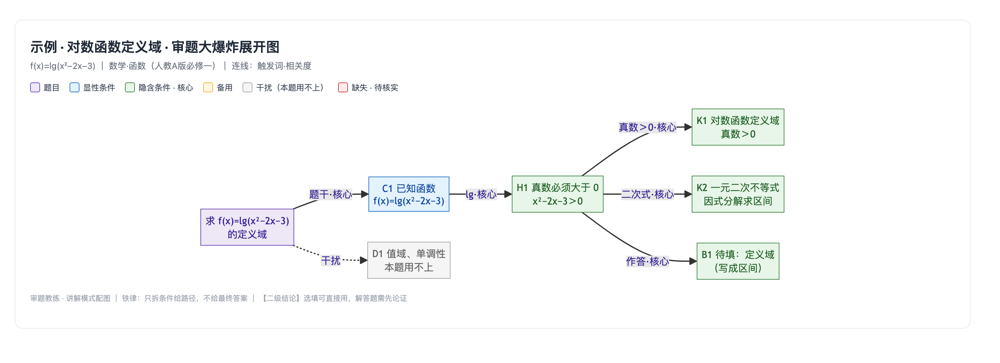

# 讲解模式完整示例（数学）

题目：已知函数 f(x)=lg(x²−2x−3)，求 f(x) 的定义域。

（本示例改用 `examples/demo-spec.json` 的同一道定义域题，复用仓库已有 `examples/demo-bigbang.png`，使文本树与现有图一致；未重新渲染，也不冒充新生成图片。按现有图的副标题采用人教A版必修一作教学映射；辽宁默认仍为人教B版。人教B版（2019 课标版）的对数主题对应必修第二册第四章，原目录待复核，详见 `liaoning-textbook-map.md`。）

〇、题目复述与题型识别

30 秒速览：
①这题在问什么：求 f(x)=lg(x²−2x−3) 有意义时 x 的取值范围。
②最关键的触发词：“lg”和“x²”。
③最容易踩的坑：把真数允许等于零，或把真数的范围当成 x 的范围。

已知函数 f(x)=lg(x²−2x−3)，求 f(x) 的定义域。高一 · 数学 · 函数 · 解答题（定义域约束，无显式下划线但有一个“求”的作答点）。

一、目标分析

| 小问 | 问什么 | 从哪类条件入手 |
| --- | --- | --- |
| Q1 | 求函数的定义域，并将 x 的允许取值写成区间（B1） | 由 C1 的“lg”触发 H1 的真数约束，再用 C1 中的二次式判断范围 |

倒推：先判断函数式在哪些 x 处有意义；定义域描述的是自变量的允许取值，不是函数值的范围。

二、显性条件表

| 编号 | 来源 | 条件原文 | 类型 | 触发词 | 对应知识点/定理 | 考纲与教材对应 |
| --- | --- | --- | --- | --- | --- | --- |
| C1 | 题干 | 已知函数 f(x)=lg(x²−2x−3) | 关系 | “lg”“x²” | 对数函数的真数约束；一元二次不等式的求解 | 课标：理解对数的概念，会求简单函数的定义域，会解一元二次不等式（转述）。教材：人教A版（2019 课标版）必修第一册 第四章 指数函数与对数函数 + 第二章 一元二次函数、方程和不等式（节次待核实）。内容：log_a N 要求 a>0、a≠1、N>0，lg 的底数为10；一元二次不等式可借助因式分解或二次函数图象判断符号 |

空白作答卡（没有显式空位，但“求定义域”是一个隐含作答点）：

| 空号 | 小问 | 待填类型 | 判断依据（不写答案） |
| --- | --- | --- | --- |
| B1 | Q1 | 区间 | 由 C1 的“lg”核对 H1，再按二次式符号确定 x 的允许取值并检查端点 |

三、隐含条件表

| 编号 | 隐含条件 | 来源 | 类型 | 触发词 | 相关度 | 对应知识点 | 考纲与教材对应 |
| --- | --- | --- | --- | --- | --- | --- | --- |
| H1 | x²−2x−3>0（真数必须为正） | 由 C1 的“lg”触发 | 定义域约束 | “lg” | 核心 | 对数真数>0；解一元二次不等式 | 课标：理解对数的概念，会解一元二次不等式（转述）。教材：人教A版（2019 课标版）必修第一册 第四章 指数函数与对数函数 + 第二章 一元二次函数、方程和不等式（节次待核实）。内容：将真数作为整体要求其大于0，再用二次式符号判断自变量取值；本行只列约束，不给最终区间 |

其他隐含类：无本题必需的图形隐含、结构信号、额外术语展开或二级结论；不为凑条目添加条件。

四、大爆炸展开图

```
ROOT：Q1 求 f(x)=lg(x²−2x−3) 的定义域
├─ C1 已知函数 f(x)=lg(x²−2x−3)（题干·核心）
│   └─ H1 真数必须大于0，x²−2x−3>0（lg·核心）
│       ├─ K1 对数函数定义域：真数>0（真数>0·核心）
│       ├─ K2 一元二次不等式：因式分解求区间（二次式·核心）
│       └─ B1 待填：定义域，写成区间（作答·核心）
└─ D1 值域、单调性：本题用不上（干扰）
```

已有图与上面的条件、关系、B1 作答点一致：



MEDIA:<仓库绝对路径>/examples/demo-bigbang.png

（该 MEDIA 行是格式占位；实际交付时替换为当前仓库中已有 PNG 的真实绝对路径，不能原样发送占位路径。此处复用已有图，不声称执行了渲染命令。）

五、收敛·路径提示

Q1（B1）：
1. 写出 H1 的真数约束，将定义域问题转为二次不等式问题。
2. 用因式分解判断二次式符号，确定自变量的允许取值。
3. 核对严格不等式的端点要求，再按区间格式填写 B1。

六、陷阱提醒

“真数>0”不是“真数≥0”；“定义域”问 x 的范围，不是 y 的值域。求定义域无需先求单调性，别让 D1 的关联知识带偏目标。

七、审题收获

见对数先核对真数约束，再把约束转成自变量的取值条件；没有下划线的“求”也要建 B 卡。

（注意：示例遵守“默认不解题”铁律，未给出最终区间。多题讲解时，每题完整输出八模块；训练模式按当前阶段输出，不照搬本示例一次性展开。）
